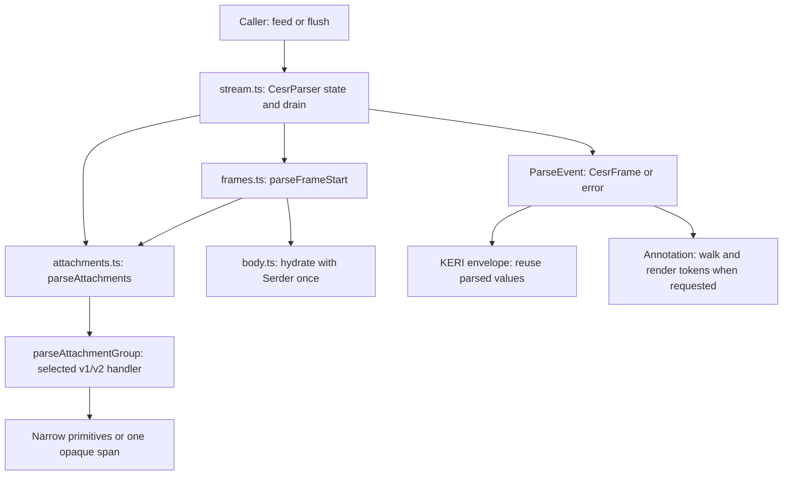
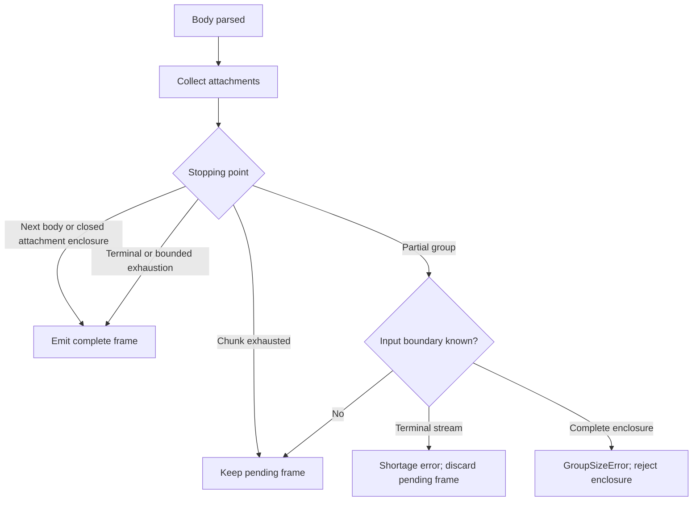

# Historical CESR Atomic Bounded Parser Architecture

> Historical record retained from the pre-reorganization tree at
> `691998a2317881db484f216c00e81a68030dc3a2`. Status, paths and proposed
> actions below describe that record, not current implementation or authorization.
> Use [current plans](../../../plans/README.md) for remaining work.

This implementation has been removed. This document records its historical
tradeoffs; the current [state-machine contract](../../../design-docs/cesr/CESR_PARSER_STATE_MACHINE_CONTRACT.md)
and [progressive contract](../../../design-docs/cesr/CESR_PROGRESSIVE_PARSER_CONTRACT.md) govern all callers.

The former stream parser kept one open frame and complete queued siblings.
Nested counted payloads were bounded and parsed atomically, with no resumable
nested parse stack. The sections below describe that removed implementation.

## Ownership

`common.ts` contains frame-family names and selector constants. `core/domain.ts`
provides byte widths shared with primitives. These modules carry no parser state.

## Completion

A complete `BodyWithAttachmentGroup` contains exactly one frame. A complete
`GenericGroup` can contain several; ordered siblings are queued before parsing
outside bytes. `framed` limits emissions per feed, not parsing boundaries.
`flush()` drains all complete frames and is idempotent.

## Version scopes

`streamGvrsn` is null until explicitly selected. `parseFrameStart` may infer
legacy framing only while unselected. It returns the resolved frame `gvrsn`
separately, so a v1 body cannot silently replace an explicit v2 stream genus.
Body protocol `pvrsn` remains distinct from both.

Enclosures pass their genus to children. Scoped selectors change subsequent
siblings only within that payload. Boundary probes and attachment readers use
the selected genus without fallback. Unsupported selectors and malformed
selected-version payloads fail.

## Attachment lengths

V1 signature and tuple groups count items; v2 counts payload units. Sized v1
wrappers also count payload units. Text units are four bytes; binary units are
three. Bound payload lengths before decoding items, and require exact exhaustion.
A complete enclosure cannot borrow bytes from a peer to finish an inner item.

Wrappers recurse through their bounded group payloads. There is no recovery
branch for malformed tails. Only wire families whose contents are intentionally
opaque produce `OpaqueSpan`; each span preserves the original bytes and domain.

## Deliberate limits

Native bodies hydrate once through Serder. Annotation's token walk exists only
for presentation. Runtime envelopes reuse typed primitives and validate roles at
the public frame boundary.

The approved many-message ESSR workload now motivates progressive nested
emission. Migration and benchmark gates are defined by ADR-0012; this atomic
implementation remains in service only until that migration completes.
