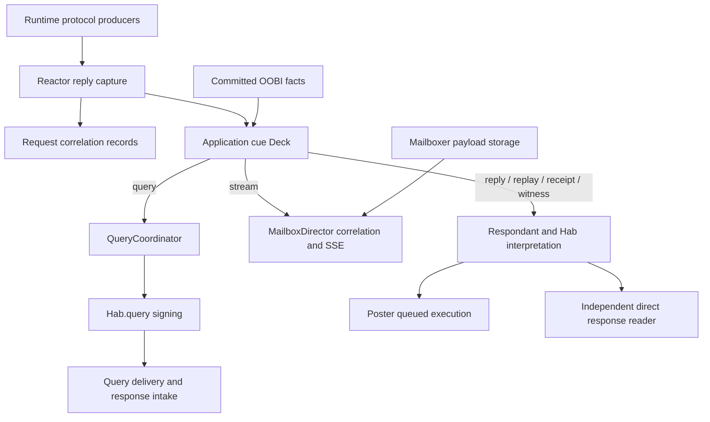

# Cue ownership in KERIpy and keri-ts

Cues are ordinary records describing facts or follow-up work. They are neither
transport payloads nor synthetic resource handles. A Deck has a consumer; it is
not broadcast. [ADR-0013](../../adr/adr-0013-simple-component-flows.md) governs
component ownership and explicit contracts.

The [cue delivery refactor](../../plans/runtime/cue-delivery-refactor.md) is in
progress. Poster now owns every queued send and runs independently of query
delivery. Existing cue traversal/retry behavior remains while callers migrate to
the single execution owner; the plan tracks qualification and later simplification.

KERIpy is the behavioral reference. Its mailbox host is supplied by the declared
fork, not current upstream. Keep these sources distinct using the
[reference inventory](../../plans/qualification/REFERENCE_ENVIRONMENTS.md).

## Production, interpretation and delivery

Processors publish cues after their owning writes commit. Interpretation constructs
protocol messages using the controller state that can honestly sign. Concrete
output workers perform network delivery outside protocol transactions.

KERIpy uses shared dict-shaped cue Decks, BaseHab.processCuesIter and host/query
doers. keri-ts preserves that model with typed records and Effection operations.
Kever returns follow-up data in its decision; Kevery applies the decision and
publishes the resulting cues. Kever does not own another output queue.

There are three cue scopes in keri-ts:

| Scope           | Producer and consumer                                                                                                                                        |
| --------------- | ------------------------------------------------------------------------------------------------------------------------------------------------------------ |
| Habery-local    | Habery.kevery has its own Deck for local habitat processing, independently of any host                                                                       |
| Protocol output | Runtime Kevery, Revery, Exchanger and legacy TEL/verifier processors share the protocol Deck; Reactor captures request-correlated replies before publication |
| Application     | AgentRuntime.cues receives remaining protocol records and committed application/OOBI facts; composition routes each to its concrete owner                    |

Do not wire runtime producers to a private Deck that their consumer never sees.
Conversely, merging local and runtime scopes would make local habitat processing
depend on a host and could let background consumers steal request replies.

## Application routing

`processCuesOnce` / `cueDo` live at composition and implement that routing.
QueryCoordinator resolves the local signer and remote attester, snapshots signed
query/introduction bytes, and joins response I/O. An unavailable explicit signer
stays unresolved; no multi-Hab guessing occurs. Schema/credential recovery notices
remain notify-only rather than becoming invented logs queries.

Hab.interpretCue / processCuesIter construct receipt, reply and replay output.
Direct component callers can also interpret a query whose signer/attester are
already resolved; the runtime query path uses QueryCoordinator and Hab.query.
CueEmission retains the original cue and distinguishes wire, notify and transport
results. The root routes stream records directly to MailboxDirector; it does not
need a Hab emission or host sink to do so.

Respondant interprets cues, prepares routing and publishes reply work. Poster owns
reply cursors, once-signed retry packets, delivery progress, active transport and
joined cleanup, including authorized local forwarding. The temporary
`enqueueReplies` boundary transfers prepared reply descriptions into the same
private queue as ordinary Poster events. Mailboxer stores provider
payloads; MailboxDirector correlates stream queries and serves those payloads.
A successful `/fwd` write does not prove the query-to-SSE bridge works.

## Record and resource boundaries

Interpret/prepare and publish successfully before removing a source record.
Preparation failure leaves it pending. Finite passes use their initial extent;
newly appended work waits for another pass. Notify-only or no-emission cues can
still be consumed. Do not restore CueSink hooks, preparation callbacks or generic
delivery wrappers to enforce this ordinary sequencing.

All ordinary Poster callers publish with `send({ src, dest, topic, msg, ... })`;
admission copies the signed source bytes and returns a new concrete event identity.
Callers requiring completion opt into `{ notify: true }` and use `wait(evt)` to
consume that event's `sent` or `failed` outcome from `cues`. Reusing the same signed
message creates a different admission; an older SAID success cannot satisfy it.
Only one waiter may observe an admission. Cancelling it releases the observation
without cancelling queued delivery. Pending work depends on queued/active work,
not the number of unconsumed outcome cues. Local send completion is not remote
protocol acceptance.

EXN producers construct and sign with `createExchangeMessage` outside Poster.
The standalone `sendExchangeMessage` helper accepts `dest`, starts its own worker,
waits for its concrete admission, and joins cleanup. Runtime callers use the
existing host worker. There is no alternate immediate-send Poster API.

The host runs `Poster.deliverDo` independently of query response intake. HTTP and
witness ingress publish without calling `Poster.process`; direct response readers
keep their request-owned lifetime. Focused tests may explicitly process Poster.

The temporary cue path retains its finite outgoing pass: initially queued items rotate
after one target attempt, and an observed refusal creates an independent retry of
the exact prepared packet. Unexpected preparation/transport failures preserve the
current cue work and propagate. Ordinary events, cue batches and retry packets
temporarily share one private queue. Phase 3 owns removal of the
manual cursor and universal emission wrapper, eager replay and explicit failed
events; FIFO and no automatic retry must not be assumed from queue consolidation.

QueryReplies reservations are request-SAID correlation, not capacity. They capture
before ordinary cue delivery; request owners inspect and take plain records after
publishing their output. Exact current dispatch authorization still controls access.

Queues are ephemeral. OOBI worklists, protocol escrows, accepted evidence and
mailbox data/cursors retain their actual durable owners. Lazy replay readers,
HTTP bodies and sockets need cancellation and joined cleanup; ordinary cue records
do not. UI notification storage and Signaler hints are a separate observation path.

## Reference source map

| Responsibility         | KERIpy                                                               | keri-ts                                                            |
| ---------------------- | -------------------------------------------------------------------- | ------------------------------------------------------------------ |
| Protocol cues          | core/eventing.py, core/routing.py, peer/exchanging.py                | core/eventing.ts, core/routing.ts, app/exchanging.ts, core/cues.ts |
| Habitat interpretation | app/habbing.py BaseHab.processCuesIter                               | app/habbing.ts Hab.interpretCue / processCuesIter                  |
| Deferred queries       | app/querying.py and app/agenting.py WitnessInquisitor                | app/querying.ts QueryCoordinator and continuations                 |
| Reply delivery         | app/storing.py Respondant, app/forwarding.py                         | app/respondant.ts, app/forwarding.ts                               |
| Mailbox host           | fork app/mailboxing.py setupMailbox / MailboxStart                   | app/mailbox-director.ts and application host composition           |
| Query-to-SSE           | app/indirecting.py HttpEnd / QryRpyMailboxIterable / MailboxIterable | app/mailbox-director.ts, app/mailbox-sse.ts                        |
| Runtime routing        | host cueDo operations                                                | app/agent-runtime.ts, app/cue-runtime.ts, app/reactor.ts           |

The [flow reference](../../reference/runtime/CUE_FLOWS.md) follows concrete mailbox,
reply, query and continuation paths. [Query/reply contracts](QUERY_REPLY.md) retain
signer, attester and watcher rules. The [runtime contract](INGRESS_AND_EGRESS.md)
owns exact I/O, transaction and cleanup invariants. Actual composed qualification,
not the architecture diagram, establishes interoperability.
